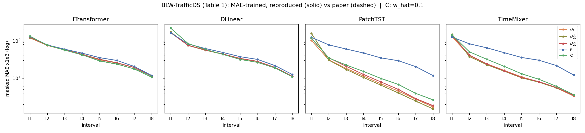
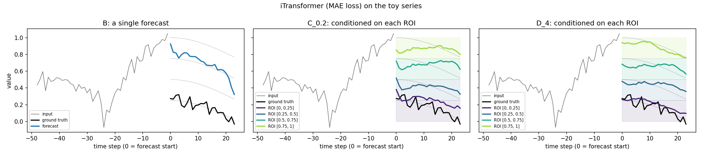
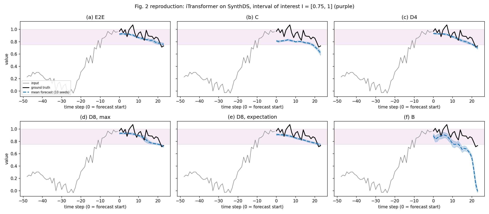
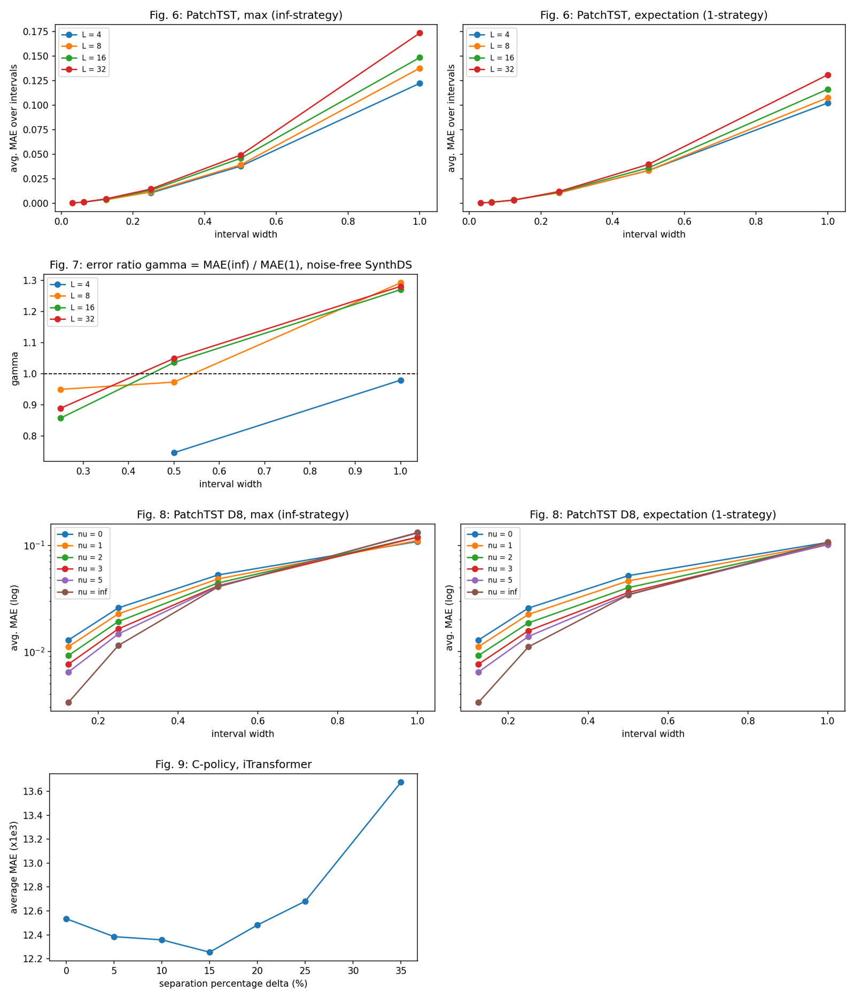
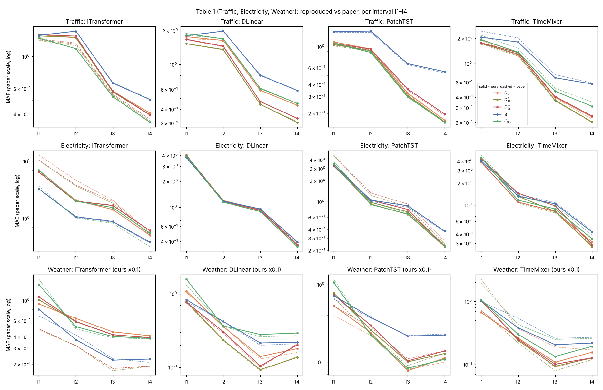
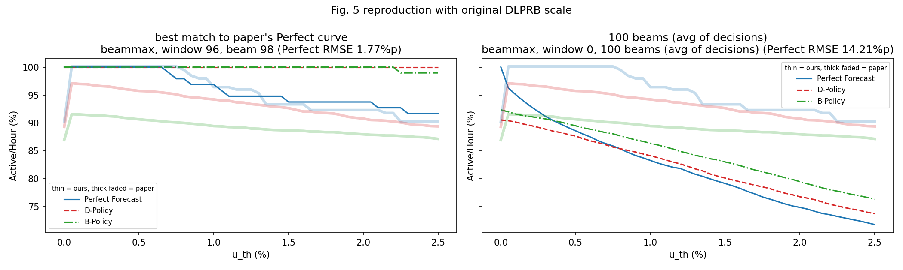

# *Goal-Oriented Time-Series Forecasting* (GOTSF) Colab 재현

다음 논문을 독립적으로 재현한 저장소입니다.

> L.-A. Fechete, M. Sana, F. Ayed, N. Piovesan, W. Li, A. De Domenico, T. Si Salem, **Goal-Oriented Time-Series Forecasting: Foundation Framework Design**, NeurIPS 2025 Workshop BERT²S, [arXiv:2504.17493](https://arxiv.org/abs/2504.17493) (2025).
> 공식 코드: [netop-team/gotsf](https://github.com/netop-team/gotsf)

| 노트북 | 내용 |
|---|---|
| [](https://colab.research.google.com/github/jykim-UC/GOTSF_Colab_Reproduction/blob/main/GOTSF_Colab_Reproduction.ipynb) `GOTSF_Colab_Reproduction.ipynb` | 메인 실험: BLW-TrafficDS와 SynthDS의 Table 1 |
| [](https://colab.research.google.com/github/jykim-UC/GOTSF_Colab_Reproduction/blob/main/GOTSF_Colab_Additional_Experiments.ipynb) `GOTSF_Colab_Additional_Experiments.ipynb` | 추가 실험: Fig. 2(E2E 정책), Fig. 5, Fig. 6–9, Traffic·Electricity·Weather의 Table 1 |

English: [README.md](README.md)

> **비공식 재현 저장소입니다.** 논문 저자 및 Huawei와 관련이 없으며, 원본 코드와 데이터의 권리는 원저작자에게 있습니다.

두 노트북 모두 실행할 때 공식 저장소를 고정된 커밋(`31b17e5`)으로 내려받고, Colab에서 실행하는 데 필요한 부분만 패치합니다. 학습과 평가 로직은 공식 코드 그대로입니다.

## 요약

| 실험 | 결과 |
|---|---|
| **Table 1, BLW-TrafficDS** (논문이 새로 공개한 데이터셋) | ✅ 20칸(모델 4개 × 정책 5개) 모두 논문과 0–1% 이내 |
| **Table 1, SynthDS** | ✅ 평균과 경향 일치(B 대비 개선율 57–66%, 논문 52–63%). 논문이 쓴 합성 데이터가 공개되지 않아 구간별 값은 최대 40–60% 차이 |
| **Fig. 2와 E2E 정책** | ✅ 경향 재현. B는 일치(34.1 대 33.7), 구간 조건부 정책은 논문보다 10–20% 높음 |
| **Fig. 6–9** (민감도 분석) | ✅ 모든 경향 재현. Fig. 6은 수치도 가까움 |
| **Table 1, Traffic** | ✅ 20칸 중 15칸이 ±5% 이내. 논문과 비교해 고른 설정 두 가지를 사용([아래 표](#논문과-비교해-고른-설정)) |
| **Table 1, Electricity** | ◐ DLinear 전체, 세 모델의 D_L, iTransformer·DLinear의 B가 0–5% 이내. patching 열은 신뢰할 만한 비교가 어려움 |
| **Table 1, Weather** | ◐ 재현값이 논문의 약 10배. 표의 "×2" 배율 표기를 "×0.2"로 읽으면 세 모델의 B와 DLinear 다섯 열 중 네 열이 6% 이내 |
| **Fig. 5** (에너지 절감) | ❌ Perfect Forecast 곡선과 B 정책은 일치하지만, D가 에너지 오차를 약 1/3로 줄인다는 결과는 재현 안 됨. 공개 데이터에 저장소의 시계열이 없음 |

정책 이름: **B** = 일반 학습, **C** = 연속 구간 무작위 샘플링, **D_L** = 구간 L개로 이산화(patching 없음), **D¹₂L / D∞₂L** = 2L개로 학습한 뒤 확률 가중 평균 / 최대 확률로 patching. 지표는 논문과 공식 코드와 같은 마스크 MAE로, 정답이 해당 구간에 속한 위치만 계산합니다.

## 메인 결과 (`GOTSF_Colab_Reproduction.ipynb`)

### BLW-TrafficDS: I1–I8 평균 MAE ×10³ (재현 / 논문)

| 모델 | D_L | D¹₂L | D∞₂L | B | C ¹ | B 대비 개선율 |
|---|---|---|---|---|---|---|
| iTransformer | 47.6 / 47.8 | 48.6 / 48.6 | 48.8 / 48.6 | 51.6 / 51.5 | 48.7 / 48.5 | 7.7% / 7.2% |
| DLinear | 54.6 / 54.5 ² | 54.9 / 54.8 | 54.3 / 54.3 | 57.6 / 57.6 | 61.7 / 61.6 | 5.7% / 5.7% ² |
| PatchTST | 22.5 / 22.4 | 28.9 / 28.8 | 25.6 / 25.5 | 50.8 / 50.7 | 26.7 / 26.7 | 55.7% / 55.8% |
| TimeMixer | 29.5 / 29.4 | 31.5 / 31.4 | 30.9 / 30.9 | 52.8 / 52.7 | 35.0 / 34.9 | 44.1% / 44.2% |



실선(재현)과 점선(논문)이 거의 겹쳐서 점선이 잘 보이지 않습니다.

### SynthDS: I1–I4 평균 MAE ×10³ (재현 / 논문)

| 모델 | D_L | D¹₂L | D∞₂L | B | C ¹ | B 대비 개선율 |
|---|---|---|---|---|---|---|
| iTransformer | 10.7 / 10.8 | 10.9 / 11.0 | 11.3 / 12.3 | 25.8 / 29.1 | 12.0 / 13.2 | 58.4% / 62.9% |
| DLinear | 13.8 / 13.8 | 13.4 / 13.6 | 14.7 / 15.1 | 39.2 / 32.3 | 18.6 / 17.1 | 65.8% / 57.9% |
| PatchTST | 10.3 / 10.7 | 10.8 / 11.2 | 11.1 / 12.1 | 26.4 / 29.1 | 11.4 / 12.3 | 61.0% / 63.3% |
| TimeMixer | 14.0 / 13.7 | 13.8 / 14.2 | 15.5 / 16.5 | 32.2 / 28.3 | 14.6 / 14.6 | 57.1% / 51.7% |



일반 학습(B)은 네 가지 미래 가설의 중간값 하나만 내놓고, 구간 조건부 정책(C, D)은 관심 구간마다 해당 가설을 따라갑니다.

¹ C 열은 `w_hat = 0.1`(저장소 `train.sh` 설정)로 학습한 결과입니다. 논문 표기는 C₀.₂지만, BLW-TrafficDS에서 `w_hat = 0.2`는 최대 +7.6%(TimeMixer) 벗어나는 반면 `w_hat = 0.1`은 네 모델 모두 0.2% 이내로 일치합니다.

² 논문 표에 적힌 DLinear D_L 평균은 54.0, 개선율은 6.3%입니다. 같은 표의 구간별 값(I1–I8)을 평균하면 54.5, 개선율은 5.7%라서 후자를 적었습니다.

## 추가 실험 (`GOTSF_Colab_Additional_Experiments.ipynb`)

### Fig. 2와 E2E 정책

SynthDS에서 iTransformer, 관심 구간 I = [0.75, 1], 시드 10개, MAE 손실, 66/17/17 분할입니다. E2E는 구간 하나([0.75, 1])로만 학습하는 이산 정책으로 구현했습니다(지시 함수 손실, 분류 손실 끔).

| 정책 | 재현 (평균 ± 표준편차, 시드 10개) | 논문 (Table 1, SynthDS I4) |
|---|---|---|
| (a) E2E | 14.35 ± 0.29 | – |
| (b) C (w_hat = 0.2) | 16.41 ± 0.24 | 13.4 |
| (c) D₄ | 14.75 ± 0.23 | 13.1 |
| (d) D₈, max (D∞₈) | 15.88 ± 0.54 | 13.6 |
| (e) D₈, expectation (D¹₈) | 14.22 ± 0.26 | 12.4 |
| (f) B | 34.14 ± 0.66 | 33.7 |



논문의 설명이 그대로 재현됩니다. D 정책은 E2E에 가깝고, C는 구간 조건부 정책 중 가장 약하며, B는 가능한 미래들을 평균 내서 오차가 두 배 넘게 큽니다. 구간 조건부 정책의 절댓값이 Table 1보다 10–20% 높은 것은 합성 데이터가 다르기 때문입니다.

### Fig. 6–9: 민감도 분석



아래 값은 우리 그래프와 논문 그림에서 읽은 것이라 근삿값입니다.

- **Fig. 6** (PatchTST, D_L, L ∈ {4, 8, 16, 32}): 구간 폭이 넓을수록 오차가 커지고, 넓은 구간에서는 L이 클수록 나쁩니다. max patching 기준 폭 1에서 약 0.12–0.17로 논문(0.12–0.155)과 가깝습니다. 논문은 어떤 patching을 썼는지 밝히지 않았는데, 이 결과로 보면 max입니다.
- **Fig. 7** (노이즈 없는 SynthDS): 오차비 γ = MAE(max) / MAE(expectation)가 좁은 구간에서는 1보다 작고, 폭 1에서는 L = 8, 16, 32 모두 약 1.27–1.29입니다(논문 약 1.2–1.33). L = 4만 예외입니다(0.98).
- **Fig. 8** (PatchTST D₈, decay ν): 좁은 구간일수록 ν가 클수록 좋고(폭 1/8에서 ν = ∞ 약 0.003, ν = 0 약 0.013), 폭 1에서는 모두 비슷해집니다. 논문과 같은 경향입니다.
- **Fig. 9** (C 정책, iTransformer, 최소 구간 폭 δ):

| δ (%) | 0 | 5 | 10 | 15 | 20 | 25 | 35 |
|---|---|---|---|---|---|---|---|
| 평균 MAE ×10³ | 12.54 | 12.39 | 12.36 | 12.26 | 12.48 | 12.68 | 13.68 |

  논문과 같은 U자 모양입니다. 최저점이 논문(약 5%)과 달리 δ = 15%에 있고, 35%에서의 값(13.68)은 논문(약 14.3)과 비슷합니다.

### Table 1: Traffic, Electricity, Weather

논문 평균은 Table 1의 구간별 값을 평균한 것입니다. **굵게** 표시한 칸은 ±5% 이내이고, 나머지는 논문 대비 차이를 함께 적었습니다.

**Traffic** (×500)

| 모델 | D_L | D¹₂L | D∞₂L | B | C₀.₂ | B 대비 개선율 |
|---|---|---|---|---|---|---|
| iTransformer | 0.94 / 0.84 (+12%) | 0.93 / 0.85 (+8%) | 0.94 / 0.87 (+8%) | **1.01 / 1.02** | **0.84 / 0.84** | 17.4% / 17.6% |
| DLinear | **1.11 / 1.10** | **0.91 / 0.91** | **0.99 / 0.98** | **1.30 / 1.29** | **1.16 / 1.15** | 29.8% / 29.9% |
| PatchTST | **0.64 / 0.62** | **0.61 / 0.59** | **0.65 / 0.63** | **1.03 / 1.00** | **0.60 / 0.61** | 41.3% / 40.6% |
| TimeMixer | **0.98 / 0.94** | **0.90 / 0.88** | **0.94 / 0.91** | 1.28 / 1.45 (-12%) | 1.02 / 1.14 (-10%) | 29.5% / 39.6% |

**Electricity** (×10⁻¹)

| 모델 | D_L | D¹₂L | D∞₂L | B | C₀.₂ | B 대비 개선율 |
|---|---|---|---|---|---|---|
| iTransformer | 2.73 / 5.03 (-46%) | 2.69 / 4.08 (-34%) | 2.69 / 4.21 (-36%) | **1.41 / 1.39** | 2.78 / 1.46 (+91%) | 0.0% / 0.0% |
| DLinear | **1.60 / 1.56** | **1.63 / 1.57** | **1.62 / 1.57** | **1.58 / 1.57** | **1.59 / 1.58** | 0.0% / 0.8% |
| PatchTST | **1.29 / 1.29** | 1.30 / 1.75 (-26%) | 1.34 / 1.81 (-26%) | **1.45 / 1.38** | 1.34 / 1.43 (-6%) | 10.6% / 6.8% |
| TimeMixer | **1.53 / 1.51** | 1.73 / 1.52 (+14%) | 1.76 / 1.54 (+14%) | 1.71 / 1.86 (-8%) | 1.72 / 1.90 (-10%) | 10.6% / 18.8% |

**Weather** (재현값을 10으로 나눔, 아래 설명 참고)

| 모델 | D_L | D¹₂L | D∞₂L | B | C₀.₂ | B 대비 개선율 |
|---|---|---|---|---|---|---|
| iTransformer | 0.61 / 0.29 (+105%) | 0.61 / 0.29 (+109%) | 0.63 / 0.29 (+112%) | 0.41 / 0.39 (+6%) | 0.70 / 0.74 (-6%) | 0.0% / 24.7% |
| DLinear | **0.44 / 0.42** | **0.31 / 0.31** | **0.35 / 0.34** | **0.42 / 0.40** | 0.63 / 0.55 (+14%) | 25.9% / 24.2% |
| PatchTST | 0.24 / 0.20 (+20%) | 0.32 / 0.28 (+13%) | 0.32 / 0.27 (+20%) | **0.38 / 0.37** | 0.37 / 0.40 (-6%) | 37.3% / 45.6% |
| TimeMixer | 0.30 / 0.74 (-60%) | 0.38 / 0.29 (+32%) | 0.38 / 0.30 (+27%) | 0.46 / 0.52 (-11%) | 0.42 / 0.72 (-41%) | 34.6% / 44.4% |



- **Traffic**: 남은 차이는 iTransformer의 D 정책(+8–12%, 학습 길이와 무관)과 TimeMixer의 B·C(끝까지 학습해도 논문보다 약 11% *좋음*)입니다.
- **Electricity**: patching 열에서 분류 확률이 원소의 최대 97–99%에서 정확히 0으로 언더플로됩니다(PatchTST, TimeMixer). 그래서 expectation patching이 사실상 단순 평균이 됩니다. 논문이 이 경우를 어떻게 처리했는지 밝히지 않아, 이 열은 신뢰할 만한 비교가 어렵습니다. iTransformer의 D 정책이 B보다 훨씬 나쁜 것은 논문도 마찬가지입니다.
- **Weather**: 그대로 비교하면 B 열이 모든 모델과 구간에서 논문의 7.1–11.8배입니다(중앙값 10.1). 모델 문제라면 이렇게 고른 배율이 나올 수 없고, 데이터도 논문 설명과 같습니다(52,696행, 21개 변수). 그래서 배율 표기 "×2"는 "×0.2"의 오기로 보고, 위 표는 그렇게 읽은 값입니다. Weather는 Traffic에서 찾은 규칙을 손대지 않고 적용한 결과로, 그 규칙의 사후 검증 역할도 합니다.

### Fig. 5: 에너지 절감

iTransformer의 B와 D⋆(L = 4, 관심 구간 [0, 0.5]를 구간 2개로 patching), 24시간 예측을 이어 96시간, 임계값 0–2.5%입니다.

| 대상 | B 에너지 오차 (Wh/일) | D 에너지 오차 (Wh/일) |
|---|---|---|
| 논문 | 950 | 337 |
| 논문의 Perfect Forecast 곡선과 가장 가까운 beam | 904 | 932 |
| 100개 beam 평균 | 1223 | 1445 |



- **원래 크기를 복원할 수 없음.** 저장소의 `wireless.csv`는 전체를 하나의 값으로 나눈 데이터(전체 평균 1)라 원래 활용률을 알 수 없습니다. 논문이 공개한 데이터셋([netop/Beam-Level-Traffic-Timeseries-Dataset](https://huggingface.co/datasets/netop/Beam-Level-Traffic-Timeseries-Dataset))에서 같은 시계열을 [`tools/fig5_data_diagnostic.ipynb`](tools/fig5_data_diagnostic.ipynb)로 찾아봤습니다. 4개 지표, 모든 기간, beam 단위와 합산 단위를 모두 확인했습니다. 상관계수 중앙값은 최대 0.69였고, 그것도 시간 차이가 24시간의 배수일 때만 나왔습니다(하루 주기만 일치). 값이 0인 비율도 `wireless.csv`는 2.7%, 공개 데이터는 20–32%로 달랐습니다. 공개본에는 저장소의 시계열이 없습니다.
- **대신 한 것.** beam마다 최댓값으로 나눠 정규화했습니다. 논문의 세 곡선은 논문 PDF의 벡터 경로에서 정확히 추출했습니다. Perfect Forecast 곡선은 데이터만으로 정해지므로, 모델 결과를 보지 않고 이 곡선과 가장 가까운 96시간 구간과 대상을 골랐습니다(RMSE 1.8%p).
- **결과.** Perfect Forecast 곡선과 B의 에너지 오차(904 대 950 Wh/일)는 논문과 맞지만, D가 B보다 낫지 않습니다.

## 논문과 비교해 고른 설정

논문에 모든 설정이 적혀 있지는 않습니다. 아래 설정은 논문 수치를 재현해서 고른 것이고, 최종 노트북의 기본값입니다.

| 실험 | 설정 | 근거 |
|---|---|---|
| BLW-TrafficDS | 부록 대신 저장소 `train.sh`(2층, `d_model=128`, Adam, `lr=1e-4`, 60 에폭, patience 25) | B가 모든 구간에서 Table 1과 0.2 이내 |
| BLW-TrafficDS | C를 `w_hat = 0.1`로 학습 | 네 모델 모두 0.2% 이내 일치, `w_hat = 0.2`는 불일치 |
| Traffic, Electricity, Weather | 부록 설정(3층, `d_model=256`, `lr=1e-3`, 50 에폭, patience 5) | iTransformer와 DLinear의 B가 일치 |
| Traffic | decay rate 37을 값 범위로 나눔(185). 논문 자체의 설명과 일치 | 세 모델의 D_L이 +13–26%에서 +1–4%로 |
| Traffic | D₈(DLinear, PatchTST, TimeMixer), PatchTST B, TimeMixer B·C의 조기 종료 끔 | 6–11 에폭에 멈췄던 실험들. 끝까지 학습하자 patching 열이 +7–63%에서 0–3%로 |
| Electricity | 원 단위 decay 37, 변경 없음 | D_L이 이미 0–2% 이내로 일치 |
| Weather | Traffic의 규칙(scaled decay, D₈ 조기 종료 없음)을 그대로 적용 | Traffic 규칙의 사후 검증 |
| Fig. 5 | beam별 최댓값 정규화, Perfect Forecast 곡선으로 구간과 대상 선택 | 위 설명 참고 |

## 논문에서 발견한 불일치

1. **Table 1, BLW-TrafficDS**: DLinear D_L 평균이 54.0으로 적혀 있지만, 구간별 값을 평균하면 54.5입니다.
2. **Table 1, BLW-TrafficDS**: C₀.₂로 표기된 열은 0.2가 아니라 `w_hat = 0.1`(저장소 설정)과 일치합니다.
3. **Table 1, Weather**: 값이 재현값보다 고르게 약 10배 작습니다. "×2" 배율 표기는 "×0.2"의 오기로 보입니다.
4. **부록 A**: 적혀 있는 학습 설정이 BLW-TrafficDS 결과와 맞지 않고, 저장소의 `train.sh` 설정과 맞습니다.
5. **Fig. 8**: 캡션은 D₈, 본문은 D₃₂라고 합니다. x축(폭 1/8–1)은 D₈과 맞습니다.
6. **SynthDS**: 논문은 3,456점과 66/17/17 분할이라고 하지만, 저장소 파일은 3,072점입니다.

## 실행 방법

**메인 노트북.** Colab 배지를 누르고 GPU 런타임에서 모두 실행합니다. 기본값이 논문 Table 1 조건입니다(MAE 손실, `RUN_MODE = "full"`, 60 에폭). `RUN_MODE = "quick"`(3 에폭)으로 빠르게 점검할 수 있습니다. NVIDIA RTX PRO 6000에서 약 15분 걸립니다.

**추가 실험 노트북.** 파트마다 스위치(`RUN_FIG2`, `RUN_FIG5`, `RUN_SENS`, `RUN_TABLE1`)가 있습니다. 데이터는 모두 자동으로 받습니다. Traffic과 Electricity는 LSTNet의 GitHub 사본에서, Weather는 [Time-Series-Library의 Hugging Face 사본](https://huggingface.co/datasets/thuml/Time-Series-Library)에서, DLPRB는 논문의 데이터셋에서 받습니다.

| 파트 | 논문 | 학습 수 | 소요 시간 (A100, 추정) |
|---|---|---|---|
| C | Fig. 2, E2E | 50 | 30–40분 |
| D | Fig. 5 | 2 | 5분 |
| E | Fig. 6–9 | 21 | 30–40분 |
| F | Table 1: Traffic, Electricity, Weather | 60 | 10시간 이상 (Weather만 T4에서 5.4시간) |

파트 F는 `USE_DRIVE = True`로 실행하세요. 결과가 Google Drive에 저장되고, 다시 실행하면 끝난 실험은 건너뜁니다.

## 학습된 가중치

[Releases](../../releases) 페이지에서 추가 실험 결과를 만든 실험 133개의 가중치를 받을 수 있습니다. Fig. 2(50개), Fig. 5(2개), Fig. 6–9(21개), Traffic·Electricity·Weather의 Table 1(60개)입니다.

| 파일 | 내용 |
|---|---|
| `gotsf_extra_checkpoints.zip` | `checkpoints_extra/<실험>/`의 `checkpoint.pth`, `args.pk`, `train_loss.npy`와 `metrics_extra.csv` |
| `metrics_extra.csv` | 위 실험들의 모든 평가 지표(MAE, MSE, RMSE) |

메인 노트북의 가중치는 약 15분이면 다시 학습할 수 있어 올리지 않았습니다. 논문과 맞춰 보는 과정에서 대체된 실험(예: 원 단위 decay로 학습한 Traffic)도 포함하지 않았습니다.

다시 학습하지 않고 평가만 하려면:
1. 추가 실험 노트북을 Colab에서 열고 0–2절(클론, 패치)을 실행합니다.
2. `gotsf_extra_checkpoints.zip`을 세션에 올리고, 클론한 저장소 안에 풉니다.
   ```python
   !unzip -q /content/gotsf_extra_checkpoints.zip -d /content/gotsf
   ```
3. `USE_DRIVE = False`로 나머지 셀을 실행합니다. 끝난 실험으로 인식해서 학습은 건너뛰고 평가만 합니다.

`checkpoint.pth`는 PyTorch `state_dict`이고, `args.pk`는 학습 인자를 담은 pickle 파일입니다. pickle은 신뢰할 수 있는 출처에서 받은 것만 여세요.

## 저장소 구조

```
├── README.md, README.ko.md
├── GOTSF_Colab_Reproduction.ipynb             # 메인 실험 (실행 결과 포함)
├── GOTSF_Colab_Additional_Experiments.ipynb   # 추가 실험 (최종 설정)
├── results/
│   ├── table1_comparison.csv                  # BLW-TrafficDS, SynthDS 논문 대비
│   ├── tables/, figures/                      # 메인 노트북 출력
│   └── extra/
│       ├── tables/                            # 추가 실험 (table1_extra_comparison.csv 포함)
│       └── figures/
├── logs/                                      # 메인 노트북 로그
│   └── extra/                                 # 추가 실험 로그
├── tools/
│   ├── fig5_data_diagnostic.ipynb             # wireless.csv가 공개 데이터에 있는지 확인 (실행 결과 포함)
│   └── package_weights.py                     # Colab 세션의 체크포인트와 지표를 묶는 스크립트
└── LICENSE
```

## 공식 코드에 적용한 패치

| # | 파일 | 수정 | 이유 |
|---|---|---|---|
| 1 | `utils/tools.py` | `np.Inf` → `np.inf` | NumPy 2.x에서 삭제 |
| 2 | `utils/tools.py` | `visual()`에서 저장 후 `plt.close()` | figure 누적 방지 |
| 3 | `layers/SelfAttention_Family.py` | `reformer_pytorch` import를 선택적으로 | 쓰지 않는 Reformer의 의존성 |
| 4 | `experiments/exp_basic.py` | GPU가 없으면 CPU 사용 | 원본은 항상 `cuda:0` 사용 |
| 5 | `experiments/exp_long_term_forecasting_*.py` | `torch.load(..., map_location=self.device)` | GPU 체크포인트를 CPU에서 평가 |
| 6 | `data_provider/data_loader.py` | `drop(['date'], 1)` → `drop(columns=['date'])` | pandas 2.x API |
| 7 | `script_train.py` | 시드를 `GOTSF_SEED`에서 읽음 (기본 2023) | Fig. 2의 시드 10개 |
| 8 | `data_provider/data_loader.py` | 분할 비율을 `GOTSF_PERC_TRAIN`, `GOTSF_PERC_TEST`에서 읽음 (기본 0.7, 0.2) | 논문의 66/17/17 분할 |
| 9 | `data_provider/data_factory.py` | 검증·테스트 배치 크기를 `GOTSF_EVAL_BS`에서 읽음 (기본: 전체 한 배치) | 큰 데이터셋의 GPU 메모리 |
| 10 | `experiments/exp_long_term_forecasting_*.py` | 구간 텐서를 배치 크기에 맞추고 예측을 이어 붙임 | 9번에 필요 |

1–6번은 두 노트북 모두, 7–10번은 추가 실험 노트북에서만 씁니다. 7–10번은 환경변수를 주지 않으면 아무것도 바꾸지 않습니다. 셸 스크립트(`train.sh` 등)는 `conda activate`, `CUDA_VISIBLE_DEVICES=1`, 16개 동시 실행을 쓰기 때문에, 노트북은 같은 인자를 Python에서 순차 실행합니다.

추가 실험 노트북은 공식 `ModelEvaluator`를 감싸는 평가 스크립트도 바꿨습니다.
- **patching 벡터화.** 공식 코드는 원소마다 Python 루프를 돌아 Traffic과 Electricity에서 수 시간이 걸립니다. 벡터화 버전은 max patching에서 비트 단위로 같고, expectation에서는 부동소수점 합산 순서만 다릅니다.
- **원본 배열을 덮어쓰지 않음.** 관심 구간이 학습한 sub-interval과 같을 때 공식 코드는 그 sub-interval의 예측을 덮어씁니다. 확률이 언더플로되자 이것이 결과를 조용히 오염시켜서, 원본 배열을 보존하게 했습니다.
- **확률이 모두 0인 경우.** patching하는 확률이 모두 0이면 expectation은 단순 평균을 씁니다. 공식 코드는 NaN이 됩니다.
- **배열 정리.** Table 1에서는 평가가 끝나면 예측 배열을 지우고 지표만 남깁니다(지우지 않으면 약 85GB).

배치 평가가 전체 한 배치 평가와 비트 단위로 같은 출력을 내는 것도 확인했습니다.

## 관찰

- **iTransformer의 분류 헤드**는 변수별 정규화(`use_norm`)를 거친 입력으로 계산되어, 각 beam의 절대 크기를 보지 못합니다. 그래서 분류 확률이 데이터에서 흔한 낮은 구간 쪽으로 쏠립니다.
- **조기 종료는 불안정합니다.** patience 5에서 Traffic의 PatchTST·TimeMixer D₈은 6–10 에폭에 멈춰 논문과 50–63% 차이가 났지만, 50 에폭을 다 학습하자 2–3% 이내가 됐습니다. 멈추는 시점은 GPU에 따라서도 달라집니다. Traffic의 PatchTST C는 L4에서 23 에폭에 멈춰 0.68이었지만, A100에서는 50 에폭을 다 돌아 0.60이었습니다.
- **결정성.** 같은 종류의 GPU에서 다시 실행하면 모든 수치가 비트 단위로 같았습니다.

## 실행 환경

| 노트북 또는 파트 | GPU (Google Colab) | 소프트웨어 |
|---|---|---|
| 메인 노트북 | NVIDIA RTX PRO 6000 Blackwell (이전 A100 실행도 같은 수치) | Python 3.13.15, PyTorch 2.11.0+cu130, NumPy 2.1.3, pandas 2.2.3 |
| Fig. 2, Fig. 6–9, Table 1 Traffic·Electricity | NVIDIA A100 40GB (Traffic D₈ 재학습은 A100 80GB, Traffic B·C 재학습 3개는 L4) | Python 3.13.16, PyTorch 2.11.0+cu130, NumPy 2.1.3, pandas 2.2.3 |
| Fig. 5, Table 1 Weather | NVIDIA T4 | Python 3.13.16, PyTorch 2.11.0+cu130, NumPy 2.4.6, pandas 2.2.3 |

공식 코드: [netop-team/gotsf](https://github.com/netop-team/gotsf) @ `31b17e5` (2025-06-05)

## 원 논문

```bibtex
@misc{fechete2025goaloriented,
  title         = {Goal-Oriented Time-Series Forecasting: Foundation Framework Design},
  author        = {Fechete, Luca-Andrei and Sana, Mohamed and Ayed, Fadhel and Piovesan, Nicola and Li, Wenjie and De Domenico, Antonio and Si Salem, Tareq},
  year          = {2025},
  eprint        = {2504.17493},
  archivePrefix = {arXiv}
}
```

## 라이선스

- **이 저장소의 노트북, 스크립트, 결과**: MIT License ([LICENSE](LICENSE))
- **공식 코드**: [netop-team/gotsf](https://github.com/netop-team/gotsf)는 MIT License이며, 저작권 표시는 원 저장소의 LICENSE를 따릅니다.
- **데이터셋**: 원 저장소와 [Hugging Face 데이터셋 페이지](https://huggingface.co/datasets/netop/Beam-Level-Traffic-Timeseries-Dataset)의 조건을 따릅니다.
- **논문 PDF**: 저작권 문제로 이 저장소에 포함하지 않았습니다.
