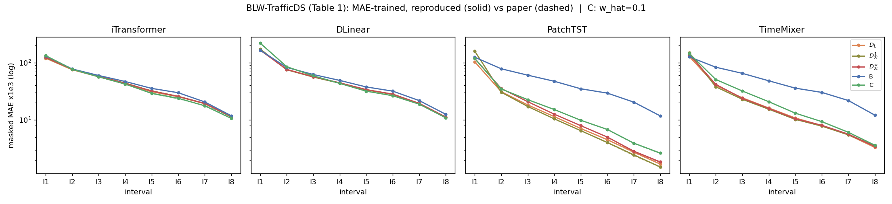
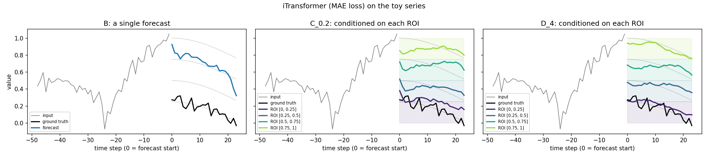

# GOTSF 재현: Goal-Oriented Time-Series Forecasting (Colab)

[](https://colab.research.google.com/github/jykim-UC/GOTSF_Colab_Reproduction/blob/main/GOTSF_Colab_Reproduction.ipynb)

> **비공식 재현 저장소입니다.** 논문 저자 및 Huawei와 관련이 없으며, 원본 코드와 데이터의 권리는 원저작자에게 있습니다.

L.-A. Fechete et al., *Goal-Oriented Time-Series Forecasting: Foundation Framework Design* (NeurIPS 2025 Workshop BERT²S, [arXiv:2504.17493](https://arxiv.org/abs/2504.17493))의 실험을 공식 코드 [netop-team/gotsf](https://github.com/netop-team/gotsf)로 Google Colab에서 재현했습니다.

노트북은 실행할 때 공식 저장소를 고정된 커밋(`31b17e5`)으로 내려받고, Colab 환경에서 깨지는 부분만 최소한으로 패치합니다. 학습 로직과 하이퍼파라미터는 수정하지 않습니다.

## 결과 요약

| 실험 | 재현 정도 |
|---|---|
| **BLW-TrafficDS** (논문 Table 1, 메인 실험) | 4개 모델 × 5개 정책의 평균 MAE가 모두 논문과 0-1% 이내. 개선율과 모델별 최고 정책도 일치 |
| **SynthDS** (논문 Table 1) | 평균과 경향이 일치(B 대비 57-66% 개선, 논문 52-63%). 구간별 값은 데이터 차이로 최대 40-60% 차이 |

### BLW-TrafficDS: I1–I8 평균 MAE ×10³ (재현 / 논문)

| 모델 | D_L | D¹₂L | D∞₂L | B | C ¹ | B 대비 개선율 |
|---|---|---|---|---|---|---|
| iTransformer | 47.6 / 47.8 | 48.6 / 48.6 | 48.8 / 48.6 | 51.6 / 51.5 | 48.7 / 48.5 | 7.7% / 7.2% |
| DLinear | 54.6 / 54.5 ² | 54.9 / 54.8 | 54.3 / 54.3 | 57.6 / 57.6 | 61.7 / 61.6 | 5.7% / 5.7% ² |
| PatchTST | 22.5 / 22.4 | 28.9 / 28.8 | 25.6 / 25.5 | 50.8 / 50.7 | 26.7 / 26.7 | 55.7% / 55.8% |
| TimeMixer | 29.5 / 29.4 | 31.5 / 31.4 | 30.9 / 30.9 | 52.8 / 52.7 | 35.0 / 34.9 | 44.1% / 44.2% |



실선(재현)과 점선(논문)이 거의 겹쳐서 점선이 잘 보이지 않습니다.

### SynthDS: I1–I4 평균 MAE ×10³ (재현 / 논문)

| 모델 | D_L | D¹₂L | D∞₂L | B | C ¹ | B 대비 개선율 |
|---|---|---|---|---|---|---|
| iTransformer | 10.7 / 10.8 | 10.9 / 11.0 | 11.3 / 12.3 | 25.8 / 29.1 | 12.0 / 13.2 | 58.4% / 62.9% |
| DLinear | 13.8 / 13.8 | 13.4 / 13.6 | 14.7 / 15.1 | 39.2 / 32.3 | 18.6 / 17.1 | 65.8% / 57.9% |
| PatchTST | 10.3 / 10.7 | 10.8 / 11.2 | 11.1 / 12.1 | 26.4 / 29.1 | 11.4 / 12.3 | 61.0% / 63.3% |
| TimeMixer | 14.0 / 13.7 | 13.8 / 14.2 | 15.5 / 16.5 | 32.2 / 28.3 | 14.6 / 14.6 | 57.1% / 51.7% |



일반 학습(B)은 네 가지 미래 가설의 중간값 하나만 내놓고, 구간 조건부 정책(C, D)은 관심 구간을 바꿀 때마다 해당 가설을 따라갑니다.

¹ **C 열은 `w_hat=0.1`(저장소 `train.sh` 설정)로 학습한 결과입니다.** 논문 표기는 C₀.₂지만, `w_hat=0.2`로 학습하면 TimeMixer에서 +7.6% 벗어나는 반면 `w_hat=0.1`은 BLW-TrafficDS의 네 모델 모두 0.2% 이내로 일치합니다. 노트북의 비교표에서는 `C_0.1 (저장소)` 열이 이 값입니다.

² 논문 표에 적힌 DLinear D_L 평균은 54.0, 개선율은 6.3%입니다. 그런데 같은 표의 구간별 값(I1–I8)을 평균하면 54.5, 개선율은 5.7%라서 구간별 값으로 계산한 값을 적었습니다.

**정책 이름**
- B: 일반 학습
- C: 연속 구간 무작위 샘플링
- D_L: 구간 L개로 이산화 (patching 없음)
- D¹₂L / D∞₂L: 2L개로 학습한 뒤 확률 가중 평균 / 최대 확률로 patching

지표는 정답이 해당 구간에 속한 위치만 남긴 마스크 MAE로, 논문 및 공식 코드와 같은 정의입니다.

## 실행 방법

1. 위의 **Open in Colab** 배지를 누르고, 런타임 유형을 GPU로 바꾼 뒤 **모두 실행**합니다.
2. 기본값이 논문 Table 1 조건입니다(MAE 학습, `RUN_MODE = "full"`, 60 에폭). 처음에는 `RUN_MODE = "quick"`(3 에폭)으로 점검해도 됩니다.
3. 소요 시간은 NVIDIA RTX PRO 6000 기준으로 약 15분입니다(무선 데이터 학습 4분, 평가 6분, toy 예제 4.5분).

### 학습된 가중치로 평가만 하기

1. [Releases](../../releases)에서 `gotsf_checkpoints.zip`을 받습니다(40개 실험).
2. 노트북의 0-2절(저장소 클론, 패치)을 실행한 뒤 zip을 `/content/gotsf/`에 풉니다.
   ```python
   !unzip -q gotsf_checkpoints.zip -d /content/gotsf
   ```
3. 나머지 셀을 실행합니다. `SKIP_IF_DONE = True`라서 학습은 건너뛰고 평가만 합니다.

`checkpoint.pth`는 PyTorch `state_dict`이고, `args.pk`는 학습 인자를 담은 pickle 파일입니다. pickle은 신뢰할 수 있는 출처에서 받은 것만 여세요.

## 저장소 구조

```
├── GOTSF_Colab_Reproduction.ipynb   # 실행 결과가 포함된 노트북
├── results/
│   ├── table1_comparison.csv        # 논문 Table 1 대비 정책별 평균 (논문 값은 구간별 값의 평균)
│   ├── tables/                      # 노트북이 만든 구간별 표 (MAE ×10³)
│   └── figures/                     # 그래프
├── logs/                            # 학습 40개 + 평가 로그
├── tools/package_weights.py         # Colab에서 가중치와 전체 지표를 Release용으로 묶는 스크립트
└── LICENSE
```

## 공식 코드에 적용한 패치

| 파일 | 수정 | 이유 |
|---|---|---|
| `utils/tools.py` | `np.Inf` → `np.inf` | NumPy 2.x에서 `np.Inf` 삭제 |
| `utils/tools.py` | `visual()`에서 저장 후 `plt.close()` | 평가 중 figure 누적 방지 |
| `layers/SelfAttention_Family.py` | `reformer_pytorch` import를 선택적으로 | 쓰지 않는 Reformer의 의존성 제거 |
| `experiments/exp_basic.py` | GPU가 없으면 CPU 사용 | 원본은 항상 `cuda:0` 사용 |
| `experiments/exp_long_term_forecasting_*.py` | `torch.load(..., map_location=self.device)` | GPU로 학습한 체크포인트를 CPU에서도 평가 |
| `data_provider/data_loader.py` | `drop(['date'], 1)` → `drop(columns=['date'])` | pandas 2.x API 변경 |

셸 스크립트(`train.sh` 등)는 `conda activate`, `CUDA_VISIBLE_DEVICES=1`, 16개 동시 실행을 쓰기 때문에, 같은 인자를 Python에서 순차 실행합니다.

## 논문과 다른 점

- **학습 설정**: 논문 부록의 설정(3층, `d_model=256`, AdamW `lr=1e-3`, 50 에폭, patience 5) 대신 저장소 `train.sh`(2층, `d_model=128`, Adam `lr=1e-4`, 60 에폭, patience 25)를 썼습니다. 이 설정의 결과가 논문 표와 일치하므로, 논문 수치도 `train.sh`로 만든 것으로 보입니다.
- **SynthDS 데이터**: 저장소에 있는 3,072점 파일과 70/10/20 분할을 썼습니다(논문은 3,456점, 66/17/17). 논문이 쓴 원본 무작위 데이터는 공개되지 않았습니다. iTransformer 외 모델은 iTransformer 스크립트의 하이퍼파라미터를 그대로 썼습니다.
- **시드**: 코드에 고정된 시드(2023) 하나만 썼습니다. 논문 그림은 10개 시드입니다.

## 재현하지 않은 실험

아래 실험은 공식 저장소에 실행 스크립트가 없어서 이 노트북에 포함하지 않았습니다.
- Table 1의 Traffic, Electricity, Weather
- E2E 정책 (Fig. 2a)
- 에너지 절감 응용 (Fig. 5)
- 하이퍼파라미터 민감도 (Fig. 6–9)

## 관찰

iTransformer의 구간 분류 헤드는 변수별 정규화(`use_norm`)를 거친 입력으로 계산됩니다. 그래서 각 beam의 절대 크기를 보기 어렵고, 분류 확률이 데이터 전체에서 흔한 낮은 구간 쪽으로 쏠리는 경향이 있었습니다. 노트북 A7-b 그림에서 확인할 수 있습니다.

## 실행 환경

| 항목 | 값 |
|---|---|
| GPU | NVIDIA RTX PRO 6000 Blackwell Server Edition (Google Colab) |
| Python | 3.13.15 |
| PyTorch | 2.11.0+cu130 |
| NumPy / pandas | 2.1.3 / 2.2.3 |
| 공식 코드 | [netop-team/gotsf](https://github.com/netop-team/gotsf) @ `31b17e5` (2025-06-05) |

## 원 논문

```bibtex
@misc{fechete2025goaloriented,
  title         = {Goal-Oriented Time-Series Forecasting: Foundation Framework Design},
  author        = {Fechete, Luca-Andrei and Sana, Mohamed and Ayed, Fadhel and Piovesan, Nicola and Li, Wenjie and De Domenico, Antonio and Si Salem, Tareq},
  year          = {2025},
  eprint        = {2504.17493},
  archivePrefix = {arXiv}
}
```

## 라이선스

- **이 저장소의 노트북, 스크립트, 결과**: MIT License ([LICENSE](LICENSE))
- **공식 코드**: [netop-team/gotsf](https://github.com/netop-team/gotsf)는 MIT License이며, 저작권 표시는 원 저장소의 LICENSE를 따릅니다.
- **데이터셋**: 원 저장소와 [Hugging Face 데이터셋 페이지](https://huggingface.co/datasets/netop/Beam-Level-Traffic-Timeseries-Dataset)의 조건을 따릅니다.
- **논문 PDF**: 저작권 문제로 이 저장소에 포함하지 않았습니다.
